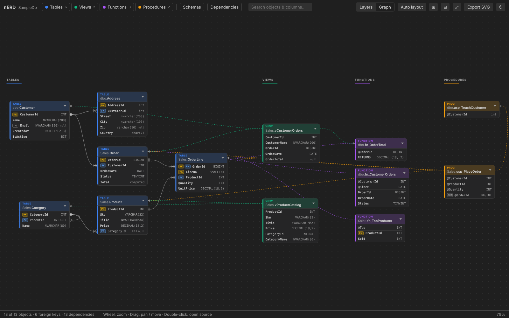
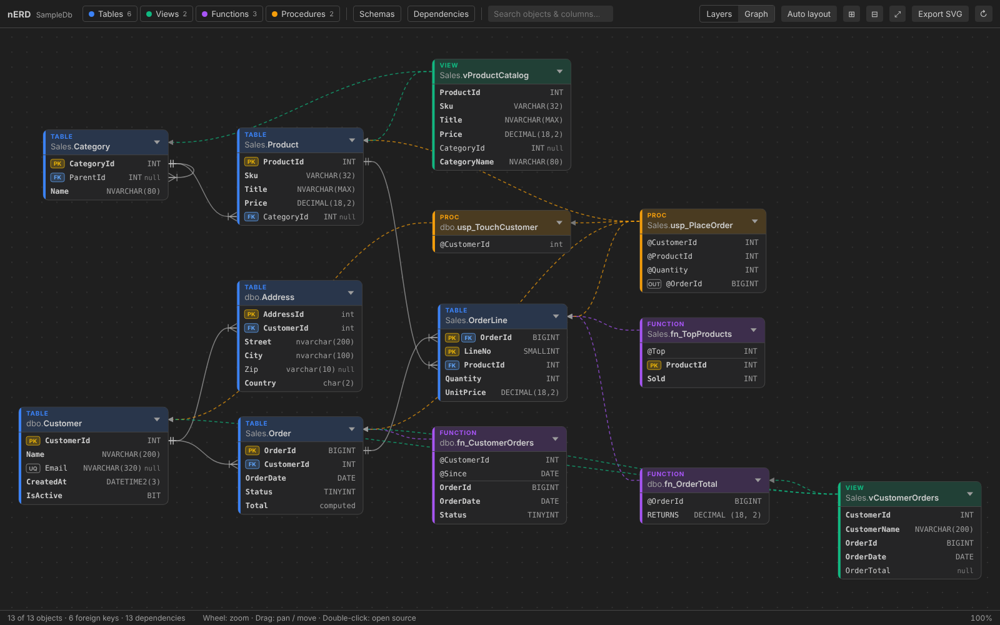

# nERD – MSSQL ERD

A VS Code extension that turns a local SQL Server database project (`.sqlproj`) into an
interactive, good-looking entity relationship diagram — tables **and** the code around them:
views, functions and stored procedures as their own layers.



## Features

- **Reads your project, not a database.** Works offline on SDK-style (`Microsoft.Build.Sql`) and
  classic SSDT `.sqlproj` files. Deploy scripts (`PreDeploy` / `PostDeploy`) and `None` items are ignored.
- **Tables** with every column, data type, `NULL` / `NOT NULL`, `PK` / `FK` / `UQ` badges, identity
  and default values. Foreign keys are drawn column-to-column with crow's-foot notation, including
  composite keys, self references and keys added later via `ALTER TABLE … ADD CONSTRAINT`.
- **Views, functions, stored procedures as layers.** Toggle each layer on or off. View columns get
  their data types from the source tables; table-valued functions show their result columns;
  functions and procedures show their parameters (`OUT` marked) and return type.
- **Dependencies.** Dashed lines show which tables, views, functions and procedures a module uses
  (`FROM`, `JOIN`, `INSERT INTO`, `UPDATE`, `EXEC`, `MERGE`, `APPLY`, function calls…).
- **Collapsible.** Collapse single objects (chevron) or everything at once to just the headers.
- **Two layouts.** *Layers* puts tables on the left and views / functions / procedures in
  columns next to the things they use. *Graph* lays everything out as one graph.
  Drag objects to arrange them yourself — the layout is remembered per project.
- **Find things.** Search objects, columns and parameters (`Ctrl/Cmd+F`, `Enter` to jump between
  hits), filter by schema, click an object to highlight its neighbourhood and see full details,
  double-click to open its source file.
- **Live.** The diagram refreshes when scripts in the project change.
- **Export** the current diagram to SVG.
- Follows your VS Code theme (light, dark, high contrast).



## Usage

- Right-click a `.sqlproj` in the Explorer → **Open ERD**, or
- run **nERD: Open ERD** from the Command Palette (picks the project in your workspace, asks if
  there are several).

| Action | How |
|---|---|
| Pan | drag the background, or `Shift` + wheel |
| Zoom | wheel / pinch, `+` / `-` |
| Fit to window | `F` or ⤢ |
| Move object | drag it |
| Details / highlight | click an object |
| Open source | double-click an object |
| Collapse | chevron in the object header, ⊞ / ⊟ for all |

### Settings

| Setting | Default | |
|---|---|---|
| `nerd.defaultSchema` | `dbo` | schema for unqualified names |
| `nerd.layout.direction` | `RIGHT` | direction of the automatic layout |
| `nerd.startCollapsed` | `false` | open new diagrams with all objects collapsed |

## Roadmap

1. **Visualize** *(this release)* — read-only ERD of a `.sqlproj`.
2. **ERD first** — design in the diagram and write it back as code: add / edit tables, columns,
   keys and relationships in the ERD and generate or update the `.sql` files in the project.
   The parser already produces a plain JSON schema model (`src/model.ts`) that is meant to be
   the single source for that code generation.

Not yet covered: triggers, user-defined types, synonyms, sequences, indexes (parsed only where they
affect keys), external projects / `.dacpac` references.

## Development

```bash
npm install
npm run build        # bundle extension + webview into dist/
npm run watch        # rebuild on change
npm run typecheck
npm test             # parser tests against test/fixtures/SampleDb
npm run package      # build a .vsix
```

Press `F5` in VS Code to start an Extension Development Host with the sample project opened.

```
src/
  extension.ts       commands, project picker
  panel.ts           webview panel, file watcher, layout persistence, SVG export
  model.ts           JSON schema model shared with the webview
  parser/
    sqlproj.ts       .sqlproj reader (SDK-style + classic, MSBuild globs)
    tokenizer.ts     T-SQL tokenizer
    tsql.ts          CREATE TABLE / VIEW / FUNCTION / PROCEDURE, ALTER TABLE ADD
    index.ts         builds the model: merges files, resolves FKs, dependencies, view column types
webview/
  main.ts            SVG rendering, interaction, toolbar, details pane
  layout.ts          ELK-based layouts (Layers / Graph)
  style.css          theme-aware styling (VS Code CSS variables)
```
